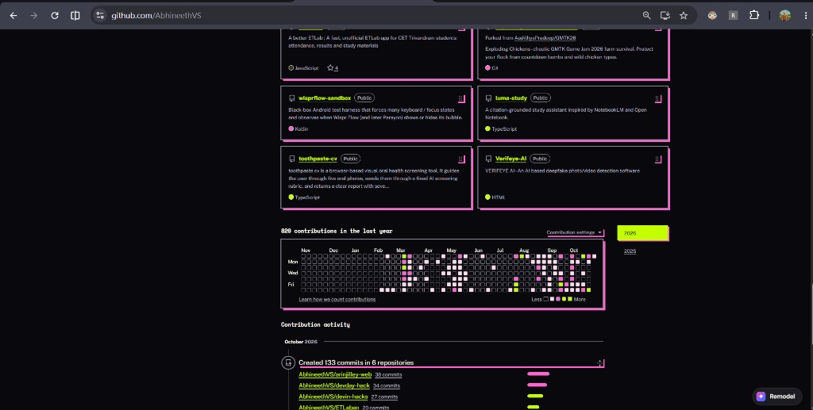
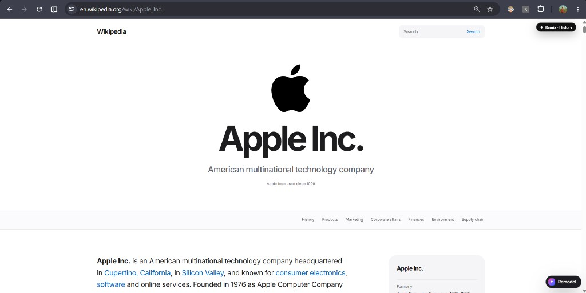
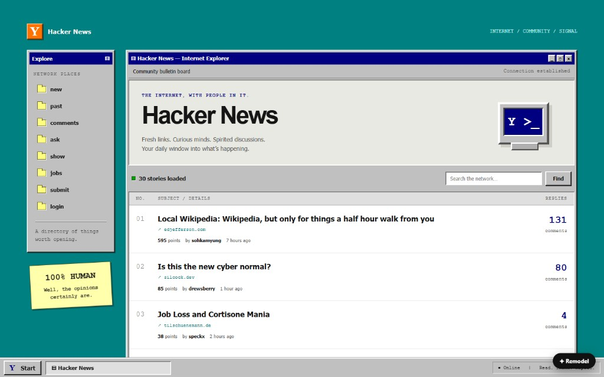
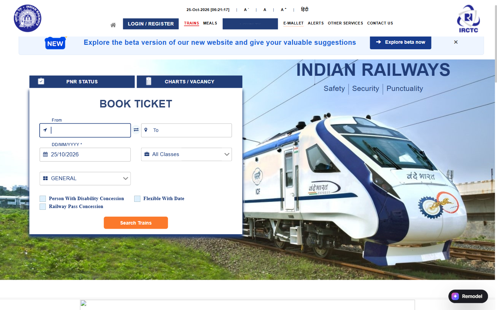
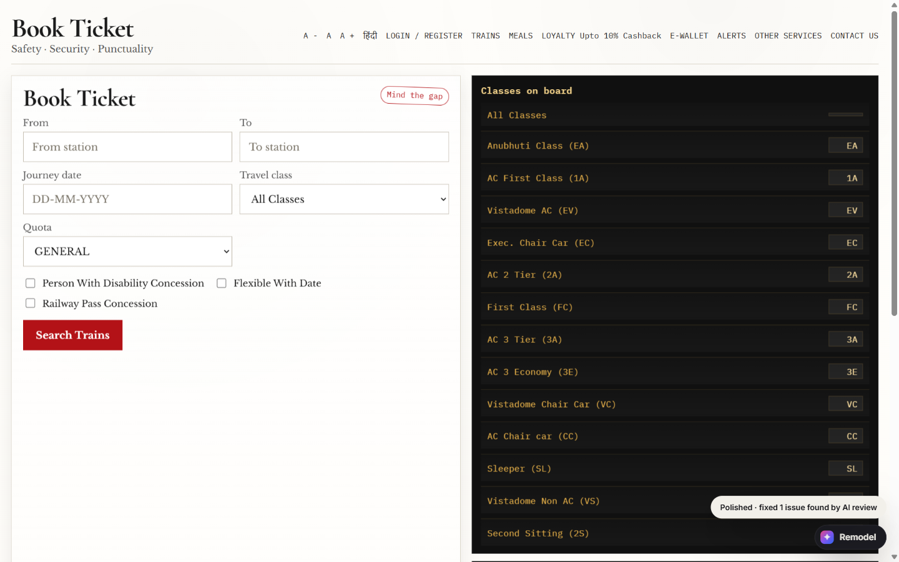

# Remodel

Give any website a new look with one sentence.

Remodel is a Chrome extension. Open a website, type a style (for example "cyberpunk" or "neo-brutalist magazine"), and Remodel redesigns the page. Links, search, logins and forms keep doing what they did before.

This repository is the showcase site. The extension source is [AbhineethVS/devin-hacks](https://github.com/AbhineethVS/devin-hacks).

A plain-text copy of this page, written for AI readers, is [`llms.txt`](llms.txt).

## Two ways to remodel

- **Reskin** (most websites). Keeps the page exactly where it is and repaints colours, fonts, corner shapes and shadows. One model call returns a small theme, and a deterministic engine applies it. About 10 seconds. With the same fonts, nothing on the page moves. A theme made on one site applies instantly on another.
- **Rebuild** (Wikipedia, Hacker News, IRCTC train search). Designs a new page from the content, with its own layout and scroll animations. The AI-written renderer runs in a sandbox with no extension access. After a rebuild, the AI looks at a screenshot of its own result and fixes obvious mistakes. On IRCTC, the new booking form still searches real trains.

## Before and after

Real results from the extension.

**GitHub, "cyberpunk / futuristic" (Reskin).** The layout stays the same. Colours, fonts and shapes change.

**Wikipedia's Apple Inc. article (Rebuild).** The whole page gets a new layout, in a clean Apple-keynote style.

**Hacker News, as a retro desktop (Rebuild).** The same live stories, inside a 90s-style computer window.

**IRCTC train search, as a calm Japanese rail planner (Rebuild).** The same booking form sits beside a station departures board listing every travel class. It still fills in IRCTC's real form, so searching shows real trains. The AI checked its own screenshot and fixed a mistake before the after shot.

## Demo videos

- [python.org, pink neo-brutalist reskin](https://youtu.be/dNEG0L8O_Oc). Same page, repainted in loud pink with thick borders and heavy type.
- [GitHub, neon reskin](https://youtu.be/Xa5lt1BeMjs). GitHub stays put. The colours and type turn neon.
- [Wikipedia's Apple article, rebuilt](https://youtu.be/PlnK9Iw7WgI). The article gets a new layout, in a clean Apple-keynote style.
- [Cyberpunk redesign](https://youtu.be/-1QaEpzxPYg). A page redesigned in a dark, neon Cyberpunk 2077 look.

## Also

- **Suggest prompts.** Remodel looks at the page and suggests three styles.
- **Reuse a style.** A style made on one site applies instantly on another.
- **Before / after switch.** Press `Alt+R` to flip between the original and the new design.
- **Remix a section.** On Wikipedia, hover any section and restyle just that part.
- **Watch it work.** While it designs, five cursors visibly edit the page, retyping headings, moving blocks and picking colours.
- **Self-check.** After a rebuild, the AI reviews a screenshot of the result and fixes obvious mistakes.

## Install

1. Open `chrome://extensions` and turn on **Developer mode**.
2. Click **Load unpacked** and choose the `extension` folder from [the extension repo](https://github.com/AbhineethVS/devin-hacks).
3. Open any website and click **Remodel** in the bottom-right, or press `Alt+Shift+M`.
4. Paste an OpenAI API key. It stays in the browser.
5. Type a style and press **Reskin this page**, or **Remodel this page** on Wikipedia, Hacker News and IRCTC.

## Good to know

- Pictures and logos keep their original colours, so a logo drawn for a light background can look off on a dark skin.
- On IRCTC, Remodel stops at train search. Login, booking and payment happen on the real IRCTC site.
- New fonts are metric-matched to the originals, but a line can occasionally re-wrap.
